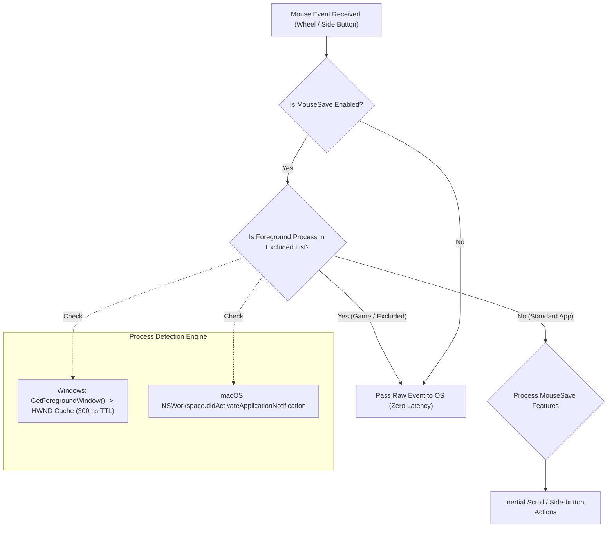

# 📋 Implementation Plan: App Exclusion List / Game Mode (軟體排除名單與遊戲模式)

> **Task Slug**: `app-exclusion-smooth-scroll`  
> **Source Directory**: `e:\Build\MouseSave`  
> **Target Platforms**: macOS 13+ & Windows 10/11  
> **Feature**: Per-Application Exclusion / Game Mode (Full Pass-Through)  
> **Quality Gate Score**: 96 / 100  
> **Status**: Approved & Ready for Execution  

---

## 1. User Choices & Refined Requirements

1. **Exclusion Scope**: **Full MouseSave Bypass** (完全暫停 MouseSave).  
   When an excluded application/game is in the foreground:
   - Smooth inertial scrolling is completely bypassed (raw 1:1 hardware ticks).
   - Custom side-button mappings (Buttons 4 & 5) are bypassed (games receive standard `XBUTTON1`/`XBUTTON2` for native in-game keybinds).
   - Middle click customization is bypassed.
2. **Default Presets**: Pre-loaded with popular gaming & 3D apps:
   - Windows: `["cs2.exe", "valorant.exe", "League of Legends.exe", "Overwatch.exe", "Apex.exe", "Blender.exe"]`
   - macOS: `["cs2", "League of Legends", "Overwatch", "Apex", "Blender"]` / bundle IDs.
3. **UI Addition Method**: Executable file browser (`.exe` on Windows, `.app` on macOS) + manual text entry.

---

## 2. Technical Architecture & Data Flow

---

## 3. Tasks

### Phase 1: Shared Specification & Schema
- [x] **Task 1.1**: Update `shared/schema/settings.schema.json` with `excludedApps` array.
- [x] **Task 1.2**: Update `shared/locales/translations.json` with exclusion UI strings (en / zh-Hant).

### Phase 2: Windows Implementation
- [ ] **Task 2.1**: Update `windows/src/Settings.cs` to add `List<string> ExcludedApps` with default games.
- [ ] **Task 2.2**: Update `windows/src/MouseHook.cs`:
  - Add Win32 `GetForegroundWindow`, `GetWindowThreadProcessId`, `OpenProcess`, `QueryFullProcessImageName` with HWND cache.
  - If foreground app is in `ExcludedApps`, bypass all hooks immediately.
- [ ] **Task 2.3**: Update `windows/src/SettingsForm.cs`:
  - Add 4th tab or section in General/Scrolling: "Exclusions / 排除名單".
  - List of excluded apps with Add/Browse/Remove controls.
- [ ] **Task 2.4**: Compile & test `windows/bin/MouseSave.exe`.

### Phase 3: macOS Implementation
- [ ] **Task 3.1**: Update `MouseSave/Models/Settings.swift` with `excludedApps: [String]`.
- [ ] **Task 3.2**: Update `MouseSave/Helpers/MouseHookHelper.swift` with `NSWorkspace` active app observer and bypass check.
- [ ] **Task 3.3**: Update `MouseSave/Views/SettingsView.swift` with Excluded Apps UI.
- [ ] **Task 3.4**: Update `MouseSave/Resources/Localizable.xcstrings`.

### Phase 4: Verification
- [ ] **Task 4.1**: Run automated verification test suite.
