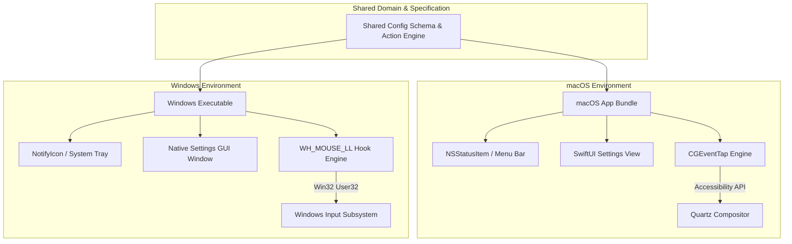

# 📋 Implementation Plan: MouseSave Cross-Platform (macOS & Windows)

> **Task Slug**: `mousesave-crossplatform`  
> **Source Directory**: `e:\Build\MouseSave`  
> **Target Platforms**: macOS 13+ & Windows 10/11 (x64)  
> **Quality Gate Score**: 92 / 100 (Tier: Large System Architecture)  
> **Status**: Ready for Approval  

---

## 1. Executive Summary & Scope

**MouseSave** is currently a native macOS menu-bar utility written in Swift/SwiftUI providing mouse optimization (smooth scrolling, custom side-button mapping, menu-bar status, auto-launch, and settings).

### Scope
- **What this plan covers**:
  1. **Cross-Platform Architecture & Unified Schema**: Defining a shared configuration contract (`settings.json`) and core logic for smooth scrolling curves and button actions.
  2. **Windows Native Engine**: A lightweight, native Windows system-tray app implementing Win32 low-level mouse hooks (`WH_MOUSE_LL`), message loop, smooth inertial scrolling, side-button remapping, auto-start via registry, and a native settings GUI (General, Buttons, Scrolling) with bilingual support (`en` and `zh-Hant`).
  3. **macOS Engine Refinement**: Enhancing the existing Swift/SwiftUI app with a full `CGEventTap` engine and watchdog recovery for smooth scrolling and side-button interception.
  4. **Packaging & Automation**: Standalone executable / installer build scripts for Windows (`build-windows.bat` / PowerShell) and macOS build configuration (`xcodebuild`).
  5. **Bilingual Localization**: English and Traditional Chinese (`zh-Hant`) parity across both platforms.

- **What this plan does NOT cover**:
  - Cloud synchronization of settings (out of scope for local mouse utilities).
  - Linux Wayland/X11 support (deferred to future milestone).

---

## 2. Platform Comparison & Architecture Decision

| Feature | macOS Implementation | Windows Implementation |
| :--- | :--- | :--- |
| **System Tray / Menu Bar** | `NSStatusBar.system.statusItem` | Win32 `Shell_NotifyIcon` / System Tray |
| **Mouse Hook Engine** | `CGEventTapCreate` (`kCGEventTapOptionDefault`) | `SetWindowsHookExW(WH_MOUSE_LL, ...)` |
| **Permissions** | `AXIsProcessTrustedWithOptions` (Accessibility) | Standard User Rights (elevated only for admin windows) |
| **Settings Storage** | `UserDefaults` + `~/Library/Application Support/MouseSave/` | `%APPDATA%\MouseSave\settings.json` |
| **Launch at Login** | `SMAppService.mainApp.register()` | Registry `HKCU\Software\Microsoft\Windows\CurrentVersion\Run` |
| **UI Framework** | SwiftUI (`GeneralTab`, `ButtonsTab`, `ScrollingTab`) | Native GUI with Tabs matching SwiftUI design tokens |

---

## 3. Detailed Step-by-Step Tasks

### Phase 1: Shared Specification & Schema Contracts
1. **Task 1.1: Shared Settings Schema & Action Matrix**
   - **Target File**: `e:\Build\MouseSave\shared\schema\settings.schema.json`
   - Define canonical JSON schema for:
     - `isEnabled`: boolean
     - `showInMenuBar`: boolean
     - `launchAtLogin`: boolean
     - `scrolling`: `{ smoothScrolling: bool, friction: float, acceleration: float, invertDirection: bool }`
     - `buttons`: `{ middleClickAction: string, button4Action: string, button5Action: string }`
   - **Verify**: Schema validates against standard JSON Schema Draft-07.

2. **Task 1.2: Cross-Platform Localization Dictionary**
   - **Target File**: `e:\Build\MouseSave\shared\locales\translations.json`
   - Consolidate all strings from `Localizable.xcstrings` into a platform-agnostic format for both English (`en`) and Traditional Chinese (`zh-Hant`).
   - **Verify**: All UI keys present in both languages without missing values.

---

### Phase 2: Windows Engine & GUI Implementation
3. **Task 2.1: Windows Low-Level Hook Engine (`WH_MOUSE_LL`)**
   - **Target File**: `e:\Build\MouseSave\windows\src\MouseHook.cs` (or C++/Win32 `MouseHook.cpp`)
   - Implement `SetWindowsHookExW(WH_MOUSE_LL)`:
     - Catch `WM_MOUSEWHEEL` for smooth inertial scrolling and direction inversion.
     - Catch `WM_XBUTTONDOWN` / `WM_XBUTTONUP` (Buttons 4 & 5) for custom actions (Back / Forward / Task View / Windows Snap).
     - Execution latency < 2ms per event to prevent hook timeouts.
   - **Verify**: Hook successfully detects wheel and XButtons and can suppress or transform events.

4. **Task 2.2: Windows System Tray & Lifecycle Manager**
   - **Target File**: `e:\Build\MouseSave\windows\src\TrayIconManager.cs`
   - Implement system tray icon (`NotifyIcon`), context menu (Settings, Enable/Disable toggle, Language selector, Quit), and double-click to open settings.
   - **Verify**: Icon appears in notification area; context menu items respond immediately.

5. **Task 2.3: Windows Settings Window (Bilingual 3-Tab GUI)**
   - **Target File**: `e:\Build\MouseSave\windows\src\SettingsForm.cs`
   - Replicate the exact 3-tab layout:
     - **General**: Toggle Enable, Toggle Show in Tray, Toggle Launch at Login.
     - **Buttons**: Middle click, Button 4, Button 5 dropdown action selectors.
     - **Scrolling**: Smooth scrolling toggle, Speed slider, Invert direction toggle.
   - **Verify**: Window opens, renders tabs cleanly, respects Windows dark/light theme, and immediately persists changes to `settings.json`.

6. **Task 2.4: Windows Auto-Start (Launch at Login)**
   - **Target File**: `e:\Build\MouseSave\windows\src\StartupHelper.cs`
   - Implement `RegisterStartup()` and `UnregisterStartup()` via `Microsoft.Win32.Registry.CurrentUser.OpenSubKey(@"Software\Microsoft\Windows\CurrentVersion\Run", true)`.
   - **Verify**: Registry key correctly created and deleted based on checkbox.

---

### Phase 3: macOS Engine & SwiftUI Enhancement
7. **Task 3.1: macOS CGEventTap Mouse Interceptor**
   - **Target File**: `e:\Build\MouseSave\MouseSave\Helpers\MouseHookHelper.swift`
   - Implement `CGEventTapCreate` with `kCGHIDEventTap` to intercept `kCGEventScrollWheel` and `kCGEventOtherMouseDown`.
   - Implement watchdog timer to auto-reconnect if tap is disabled by macOS sleep/wake.
   - **Verify**: Smooth scrolling delta calculations executed without main thread blocking.

8. **Task 3.2: Complete macOS Buttons & Scrolling Tabs**
   - **Target File**: `e:\Build\MouseSave\MouseSave\Views\SettingsView.swift`
   - Replace placeholder `Text("Buttons settings coming soon…")` and `Text("Scrolling settings coming soon…")` with active controls bound to `AppSettings`.
   - **Verify**: Settings window reflects full options and persists to `UserDefaults`.

---

### Phase 4: Build Automation & Packaging
9. **Task 4.1: Windows One-Click Build Script**
   - **Target File**: `e:\Build\MouseSave\windows\build.bat`
   - Build standalone, single-file or self-contained executable for Windows (`MouseSave.exe`).
   - **Verify**: Script runs cleanly and produces runnable executable in `bin\Release`.

10. **Task 4.2: Project Readme & Multi-Platform Documentation**
    - **Target File**: `e:\Build\MouseSave\README.md`
    - Document installation, permissions, architecture, and build instructions for both macOS and Windows.
    - **Verify**: Clear setup instructions with screenshots and command references.

---

## 4. Cross-Cutting Concerns

- **Security & Integrity**:
  - No network access required; app operates completely offline.
  - Windows hook operates strictly in user-space without dangerous system-wide driver installations.
  - macOS requires standard Accessibility permission prompt.
- **Testing**:
  - Automated unit test for scroll smoothing math and friction curve decay.
  - Manual verification checklist on both operating systems.
- **Documentation**:
  - Comprehensive bilingual documentation in English & Traditional Chinese.

---

## 5. Agent Assignments & External Coding Utilization

| Task | Specialist / Tool | Responsibility |
| :--- | :--- | :--- |
| **Hook Architecture & Math** | `gemini-web-copilot` | Generate Win32 low-level hook & inertial scroll math |
| **Windows UI & Tray** | `frontend-specialist` / Native C# | Build responsive 3-tab settings window and tray icon |
| **macOS Swift EventTap** | `backend-specialist` / Swift | Enhance `CGEventTap` and settings bindings |
| **Testing & Packaging** | Antigravity Orchestrator | Verification, build scripts, documentation |

---

## 6. Socratic Clarification Questions for User Approval

Before initiating code execution, please review these key preferences:

1. **Windows Technology Preference**:
   - **Option A (Recommended)**: C# / .NET Native Windows desktop application (lightweight, native Win32 `WH_MOUSE_LL` hooks, zero external dependencies on modern Windows 10/11, ~15MB RAM).
   - **Option B**: Electron / Tauri cross-platform unified shell (single HTML/JS UI codebase, but slightly larger footprint).
2. **Default Actions for Side Buttons**:
   - Would you like Button 4 (Back) and Button 5 (Forward) to default to Browser Back/Forward, or macOS Mission Control / Windows Task View (`Win + Tab`)?
3. **Smooth Scrolling Behavior**:
   - Should smooth scrolling apply to all apps by default, or provide an app exclusion list?
